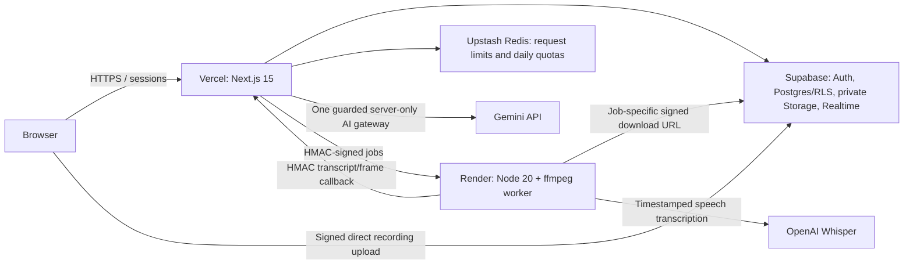

# CostLens

CostLens turns cost data from spreadsheets, documents, web sources and recordings into one project dashboard. Users review imported rows, compare estimated and actual spending, investigate anomalies, obtain AI explanations and export PDF, Excel or CSV reports. CodeAudit is the synthetic university-project example; the marketing-event demo shows the same workflow for another domain.

**Live URL:** <!-- LIVE_URL -->Not deployed/verified yet. The production verifier fills this with the actual working URL after setup.<!-- /LIVE_URL -->

**Current release branch:** `phase-2-ai-foundation`. Production deployment is prepared, not yet verified. Follow [the exact dashboard steps](docs/deployment.md); do not deploy the older `main` branch by accident.

## Architecture



Gemini replaces Claude/Anthropic at the project owner's request. `callClaude` remains a compatibility alias to the same Gemini gateway, not a second provider. The worker does not hold a database service key or call Gemini directly. The app owns authorization, privacy, quota checks, validation, usage recording and AI caching.

## Local setup

Use Node.js **22.x**, npm and a Supabase project. Docker/ffmpeg are needed for the local database/media worker workflows, not for browsing the landing page.

```sh
npm ci
cp .env.example .env.local
npm run dev
```

Edit `.env.local` securely; it is git-ignored. Configure the public Supabase URL/anon key and the necessary server credentials. Apply the migrations in `supabase/migrations` in order. [Supabase setup](docs/supabase.md) describes the local stack; [deployment](docs/deployment.md) covers migration tracking and production email confirmation. Never reset an existing database merely to apply a new migration.

Run the separate worker using [worker/README.md](worker/README.md). It needs Node 20/ffmpeg locally or its Docker image, an app origin, the shared HMAC secret and a speech key. For Docker, build from the repository root with `docker build -f worker/Dockerfile .`. The Render blueprint is `render.yaml`.

## Environment variables

`.env.example` lists the whole project's settings; `worker/.env.example` lists the smaller worker environment.

| Variable | Location and purpose |
| --- | --- |
| `NEXT_PUBLIC_SUPABASE_URL` | App/browser: production or local Supabase origin. |
| `NEXT_PUBLIC_SUPABASE_ANON_KEY` | App/browser: anon key; ownership depends on RLS, not key secrecy. |
| `SUPABASE_SERVICE_ROLE_KEY` | App/seed/verifier only: trusted database operations; never browser or worker. |
| `GEMINI_API_KEY` | App only: extraction, mapping and summaries through the shared gateway. |
| `GEMINI_MODEL_SMART`, `GEMINI_MODEL_FAST` | Optional app overrides; default is `gemini-flash-lite-latest`. Choose a model available to your Google project. |
| `UPSTASH_REDIS_REST_URL`, `UPSTASH_REDIS_REST_TOKEN` | App: REST credentials for production request limits. |
| `SOURCE_ENCRYPTION_KEY` | App: base64 of 32 random bytes for saved online-source configurations; preserve the key to keep saved sources readable. |
| `APP_URL` | App/worker/seed/verifier: canonical HTTPS CostLens origin, not the Supabase URL. |
| `WORKER_URL` | App/seed/verifier: canonical Render worker HTTPS origin. |
| `WORKER_SECRET` | App and worker: identical random server-only secret, at least 32 characters. |
| `OPENAI_API_KEY` | Worker only: speech transcription. No Anthropic key is required. |
| `TRUST_PROXY_HEADERS` | Optional app setting for a trusted proxy that overwrites forwarded IP headers; Vercel is detected automatically. |
| `DEMO_ENABLED` | App: leave `false` until production seeding is complete; set `true` and redeploy to enable public demo login. |
| `DEMO_EMAIL`, `DEMO_PASSWORD` | App/seed only: synthetic demo account; password is generated securely, at least 16 characters, never committed or sent to the browser. |
| `PORT` | Worker only: supplied by Render; local default 3001. |

All variables except the two `NEXT_PUBLIC_SUPABASE_*` entries are server-only. No secret values belong in Git, URLs or chat. Provider dashboards still require appropriate production budgets/quotas; a billing alert is not necessarily a hard spending cap.

## Tests and checks

For build prompts in Phases 3–4, follow the FAST TESTING RULES in `CLAUDE.md`: lint, typecheck and only new/changed Vitest files. Do not automatically run Playwright or the full suite.

```sh
npm run lint
npm run typecheck
npx vitest run tests/unit/demo.test.ts tests/unit/mediaMigration.test.ts tests/unit/aiClient.test.ts
```

The Next.js production typecheck excludes tests and the separate worker package. To typecheck test files as well, first install worker dependencies with `npm --prefix worker ci`, then run `npm run typecheck:tests`. Render builds/typechecks the worker using its own configuration; Vercel does not need Express installed in the app.

For explicit phase checks, the available commands are:

```sh
npm run test
npm run test:security
npm run build
npm run test:e2e
```

The security runner starts a local dev server and uses local Supabase, disposable real Redis and fake accounts. It requires a real Gemini key for its malicious-note scenario. Playwright requires a browser and a production build; the local runner can supply isolated Supabase/Redis settings. See [testing instructions](docs/testing.md), [security report](docs/security.md) and [recorded security results](docs/security-test-results.md). No full suite or Playwright run is claimed for Step 4A.

## Production and public demo

Use [docs/deployment.md](docs/deployment.md) for ordered Supabase, Upstash, Vercel, Render, confirmation-email and billing dashboard instructions. The app must use migration **0008** before enabling public demo sign-in. `npm run prepare:production` regenerates the reviewed migration bundle; it does not apply it to any database.

Once the production services, keys and ignored seed environment are ready:

```sh
npm run seed:demo -- --dry-run
npm run seed:demo
```

The first command only lists the plan. The second creates **CodeAudit – Final Year Project** from CSV, MS Project XML, a PDF invoice and the actual meeting-recording pipeline, with planted outliers and real generated insights. It creates **Sample – Marketing event** from a generated Word budget and receipt image. It checks extracted amounts against synthetic source data, commits reviewed rows, verifies recording cleanup and locks the account read-only. It never substitutes canned AI/Whisper output. A failed or incomplete seed cannot be opened through the demo button.

After a successful seed, set Vercel's `DEMO_ENABLED=true`, redeploy, and run:

```sh
npm run verify:production
```

This checks live services, email-confirmation configuration, RLS, private Storage and the complete demo login → CodeAudit flow. Only on success does it write production verification evidence and update the live URL above. SMTP delivery, billing settings and actual dashboard changes still need the operator checks in the guide.

Visitors click **Try the demo** without entering credentials. They can switch projects, filter charts/tables, inspect anomalies, choose **Show saved insights**, and export reports. Public-demo writes, uploads, account credential changes and new paid AI tasks are blocked. Existing source fixtures and generated marketing assets are synthetic. The demo uses a shared account, so read/export quotas are shared; it is not a private sandbox for each visitor.

[Report implementation](docs/reports.md), [AI safeguards](docs/ai.md), [media processing](docs/media.md), [insights](docs/insights.md) and [local Step 4A status](docs/validation-4A.md) provide further details. Live media transcription/deployment remains unverified until the production seed and verifier succeed.
